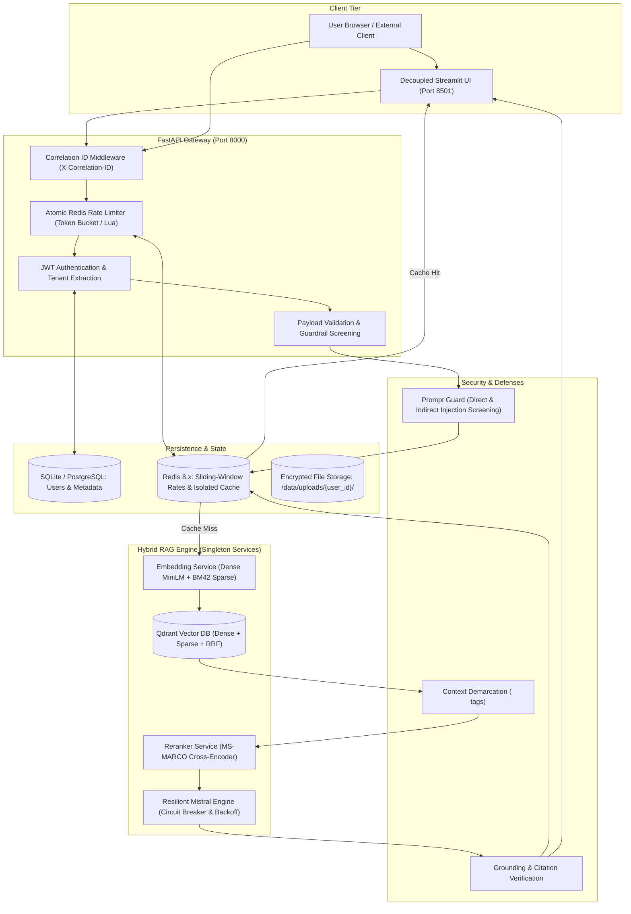

# System Architecture — Production Hybrid RAG

## 1. Architectural Overview

The production system upgrades the original prototype into a decoupled, secure, and observable multi-tenant architecture. It combines dense semantic retrieval, BM42 sparse keyword retrieval, Reciprocal Rank Fusion (RRF), Cross-Encoder reranking, and Mistral 8x7B generative synthesis under a unified, hardened FastAPI gateway.

---

## 2. Component Specifications

### 2.1 API Gateway & Middleware (`src/main.py`, `src/middleware/`)
- **Correlation ID Middleware (`correlation.py`):** Injects a unique `X-Correlation-ID` header into every HTTP request. All logs, exceptions, and downstream responses carry this identifier for end-to-end tracing.
- **Distributed Rate Limiter (`rate_limiter.py`):** Redis-backed sliding-window rate limiter executed via an atomic Lua script. Prevents race conditions and strictly isolates quotas by verified user ID (or verified client IP for unauthenticated routes). Emits standard `Retry-After` headers on HTTP 429.
- **JWT Authentication (`security/auth.py`):** Issues cryptographically signed HS256 tokens with configurable expiration (default 24h). Password hashing is performed using `bcrypt` with configurable salt work-factor.

### 2.2 Multi-Tenant Ingestion Pipeline (`src/services/ingestion_service.py`)
- **Validation:** Verifies magic bytes via `filetype` (rejects spoofed extensions), limits file size (15MB), and enforces page count limits (150 pages).
- **Punctuation-Preserving Cleaning:** Resolves the prototype bug where all punctuation was removed. Preserves sentence boundaries, mathematical notation, and syntax.
- **Deterministic Vector Namespacing:** Chunks are assigned deterministic UUIDv5 identifiers `uuid5(NAMESPACE_DNS, "{user_id}:{doc_id}:{chunk_idx}")` and indexed with `user_id` in Qdrant payloads, eliminating ID collisions.

### 2.3 Hybrid Retrieval & Reranking (`src/services/qdrant_service.py`, `src/services/rerank_service.py`)
- **Dense Embedding:** `sentence-transformers/all-MiniLM-L6-v2` (384 dimensions, Cosine distance).
- **Sparse Embedding:** `Qdrant/bm42-all-minilm-l6-v2-attentions` (exact keyword and domain-specific attention weights).
- **Fusion:** Qdrant server-side Reciprocal Rank Fusion (RRF) with mandatory payload filter: `user_id == current_user.id`.
- **Reranker:** `cross-encoder/ms-marco-MiniLM-L-6-v2` scores candidate pairs and selects top-2 passages with confidence scores.

### 2.4 Resilient Inference Engine (`src/services/llm_client.py`)
- **Circuit Breaker:** Transitions from `CLOSED` -> `OPEN` on 5 consecutive failures, fast-failing for 30s to protect downstream quotas. Tests recovery via a `HALF_OPEN` probe.
- **Exponential Backoff:** Bounded retries (max 3) with full randomized jitter for transient 429 and 5xx errors.
- **Elimination of Double Inference:** Removes the redundant `TreeSummarize` LLM call from the original prototype, cutting per-query latency and token costs by ~50%.

### 2.5 Multi-Tenant Caching (`src/services/cache_service.py`)
- **Isolated Key Format:** `cache:v1:rag:{user_id}:{sha256(scope + normalized_query)}`.
- **Automatic Invalidation:** Uploading or deleting a document automatically invalidates all cached query keys belonging to that specific user.

