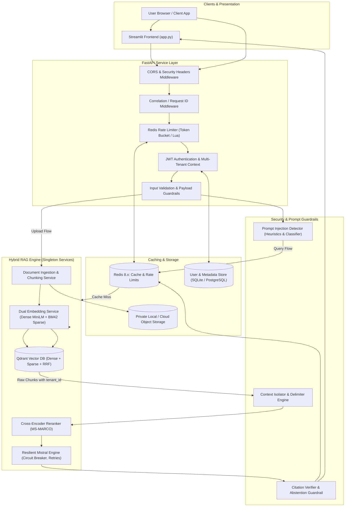

# Productionization Plan — Hybrid RAG System

**Target Architecture:** Multi-Tenant, Resilient, Secured FastAPI Backend + Decoupled Streamlit UI  
**Execution Standard:** Zero-breakage, backward-compatible, strictly validated and tested  
**Date:** 2026-11-08  

---

## 1. Architectural Strategy & Guiding Principles

1. **Preserve the Core RAG Pipeline**:
   The core Hybrid RAG design (Dense: `all-MiniLM-L6-v2` + Sparse: BM42 attentions + Qdrant RRF fusion + CrossEncoder `ms-marco-MiniLM-L-6-v2` reranker + Mistral 8x7B) will be maintained and optimized, not discarded.
2. **Decoupled Architecture**:
   Introduce a high-performance **FastAPI** service as the primary entry point for all operations (Auth, Ingestion, Query, Health, Admin). The existing Streamlit app will be updated to consume the FastAPI REST endpoints securely.
3. **Defense in Depth**:
   Security is enforced at multiple layers: Gateway (IP rate limiting, TLS headers), Application (JWT auth, RBAC, input sanitization, prompt injection detection), Vector DB (Qdrant filter enforcing `tenant_id == user_id`), and Output Guardrails (grounding checks, citation verification).
4. **Resilience by Default**:
   All external calls (Qdrant, Redis, Mistral API) will have strict timeouts, exponential backoff with jitter, and circuit breakers. Failures will gracefully degrade without crashing or exposing stack traces.

---

## 2. Target Component Architecture Diagram

---

## 3. Phase-by-Phase Implementation Blueprint

### Phase 1: Authentication, Authorization & Multi-Tenant Isolation
- **Objective:** Eliminate anonymous access. Enforce strict tenant data boundaries.
- **Components to Implement:**
  - `src/security/auth.py`: JWT token generation, verification, password hashing with `bcrypt`, token expiration.
  - `src/db/models.py` & `src/db/session.py`: Lightweight user credentials and document metadata store (SQLAlchemy with SQLite for local dev / PostgreSQL ready for production).
  - Multi-tenant vector isolation in `src/Retriever.py` & `src/indexing.py`:
    - Add `user_id` / `tenant_id` to point payloads.
    - Guarantee Qdrant `query_filter` MUST include `models.FieldCondition(key="user_id", match=models.MatchValue(value=current_user.id))`.
    - Generate unique point UUIDs (`uuid5(uuid.NAMESPACE_DNS, f"{user_id}_{doc_id}_{chunk_index}")`) instead of primitive integer IDs `0, 1, 2...`.

### Phase 2: Input Validation, Upload Pipeline & Application Guardrails
- **Objective:** Protect ingestion and query APIs from malicious, oversized, or malformed inputs.
- **Components to Implement:**
  - `src/api/schemas.py`: Pydantic V2 schemas for Document Ingestion, Query Request, Query Response, Token, User Signup/Login.
  - Fix path bug: Replace `r"\data"` with `Path(__file__).resolve().parent.parent / "data"` and configurable storage directory.
  - Fix text cleaning bug: Preserve sentence punctuation in `CustomTransformation`. Clean whitespace and normalize Unicode without stripping punctuation required by `SentenceSplitter`.
  - Secure upload handler in `src/services/ingestion.py`:
    - Magic-byte validation via `filetype` (reject disguised executables).
    - Max file size limits (default 15MB).
    - Max page count (default 100 pages).
    - File deduplication via SHA-256 hash check.
    - Sanitized UUID storage paths (prevent path traversal).
  - Query guardrails: Max query length (500 chars), min length (2 chars), request timeout enforcement.

### Phase 3: Prompt Injection & RAG-Specific Security
- **Objective:** Defend against direct jailbreaks and indirect prompt injection attacks embedded in PDFs.
- **Components to Implement:**
  - `src/security/prompt_guard.py`:
    - Heuristic & structural pattern matching (detecting instruction override markers, system prompt extraction tokens, markdown exfiltration attempts).
    - Strict delimiter isolation: Wrap all retrieved chunks in XML-style tags (`<retrieved_evidence source="..." page="...">...</retrieved_evidence>`).
    - Explicit system prompt instructions designating context strictly as untrusted reference material, forbidding instruction execution.
  - Grounding & citation guardrail:
    - Return structured chunk citations with ID, file name, and relevance score.
    - Deterministic abstention ("*I cannot answer based on the provided documents*") when retrieval score is below threshold or context is empty.
  - Adversarial security test suite in `tests/test_security.py`.

### Phase 4: Redis-Backed Distributed Rate Limiter
- **Objective:** Prevent DoS and abuse across multiple backend worker instances.
- **Components to Implement:**
  - `src/middleware/rate_limiter.py`:
    - Redis-backed sliding window rate limiter implemented via atomic Lua scripts (eliminates race conditions).
    - Separate rate limits for:
      - Auth endpoints: 5 attempts / min per IP.
      - Upload endpoints: 10 uploads / hour per user.
      - Query endpoints: 30 queries / min per user.
      - LLM heavy generation: 15 calls / min per user.
    - Client IP extraction with trusted proxy validation (preventing header spoofing).
    - Defined failure policy: Fail-closed for expensive LLM/upload routes if Redis is down; bounded fallback with warning for lightweight read operations.
    - Standard `HTTP 429 Too Many Requests` response with `Retry-After` header.

### Phase 5: Caching & Resource Management
- **Objective:** Minimize redundant LLM calls and embedding computations while preventing cross-user cache leaks.
- **Components to Implement:**
  - `src/services/cache_service.py`:
    - Redis-backed cache for hybrid search results and LLM generated answers.
    - Multi-tenant cache key specification:
      `cache:v1:rag:{tenant_id}:{doc_ids_hash}:{sha256(normalized_query)}`
    - Configurable TTL (default 1 hour).
    - Cache invalidation trigger: Automatically purge user's cached queries when a user document is added or deleted.
    - Singleton model managers: Load FastEmbed models and CrossEncoder **once** into memory at application startup, avoiding 2-second per-request reload penalties.

### Phase 6: LLM Reliability & Fault Tolerance
- **Objective:** Prevent network failures or provider downtime from crashing user requests.
- **Components to Implement:**
  - `src/services/llm_client.py`:
    - Wrap MistralAI calls with `tenacity` exponential backoff (initial 1s, max 10s, max 3 attempts) with full jitter.
    - Custom lightweight Circuit Breaker: Trip after 5 consecutive 5xx/timeout errors; fail fast for 30s before attempting half-open probe.
    - Strict HTTP timeout (default 30 seconds).
    - Error categorization: Differentiate between 401 (Bad API Key), 429 (Provider Rate Limit), 503 (Provider Down), and 400 (Context Length Exceeded).
    - Remove redundant double-inference bug (`llm.complete` + `TreeSummarize` in `generation.py`).

### Phase 7: Database & Storage Hardening
- **Objective:** Secure document payloads, metadata, and database queries.
- **Components to Implement:**
  - Parameterized ORM queries with SQLAlchemy.
  - Safe document deletion API: Deletes file from disk, document metadata from DB, and all points with `filter(user_id=..., doc_id=...)` from Qdrant.
  - Sensitive credential masking in logs and exception handlers.

### Phase 8: Observability, Logging & Telemetry
- **Objective:** Full visibility into latency, errors, and system health.
- **Components to Implement:**
  - `src/utils/logger.py`: JSON-formatted structured logging using `structlog` or standard `json` formatter with correlation ID propagation.
  - Middleware injecting `X-Correlation-ID` header into all requests and log records.
  - Latency tracking:
    - `duration_embedding_ms`
    - `duration_qdrant_hybrid_ms`
    - `duration_rerank_ms`
    - `duration_llm_ms`
    - `duration_total_ms`
  - Health & Probe endpoints:
    - `GET /health/live` (basic service liveness)
    - `GET /health/ready` (checks Qdrant connection, Redis connection, and Model readiness)

### Phase 9: Automated Testing Suite
- **Objective:** Comprehensive automated verification before any production deployment.
- **Components to Implement in `tests/`:**
  - `test_auth.py`: Token verification, password hashing, unauthenticated rejection.
  - `test_multitenancy.py`: Verification that User A cannot query or delete User B's documents.
  - `test_validation.py`: File extension, magic bytes, oversized queries, payload limits.
  - `test_security.py`: Direct injection, indirect injection in PDFs, prompt leakage, path traversal.
  - `test_rate_limiter.py`: Token bucket rate limiting, HTTP 429 and Retry-After headers.
  - `test_rag_pipeline.py`: End-to-end integration test with mocked Mistral API and ephemeral Qdrant/Fakeredis.
  - `test_circuit_breaker.py`: Circuit tripping and recovery under simulated provider outages.

### Phase 10: Deployment & Production Configuration
- **Objective:** Reproducible, production-ready environment setup.
- **Components to Implement:**
  - `src/config.py`: Centralized configuration via `pydantic-settings` with strict environment variable validation.
  - `.env.example`: Documented template for all operational parameters.
  - `Dockerfile`: Multi-stage, non-root user, slim Python 3.12 container.
  - `docker-compose.yml`: Local production simulation running FastAPI, Qdrant, Redis, and Streamlit.
  - Production entry point with graceful shutdown handling.

### Phase 11: Comprehensive Documentation
- Create:
  - `README.md` (Updated setup and quickstart)
  - `ARCHITECTURE.md` (System components, data flows, and design rationale)
  - `SECURITY.md` (Threat model, guardrails, and vulnerability reporting)
  - `PRODUCTION_DEPLOYMENT.md` (Deployment procedures, migrations, and operations)
  - `ENVIRONMENT_VARIABLES.md` (Complete reference of all settings and defaults)
  - `PRODUCTION_READINESS_CHECKLIST.md` (Itemized checklist for production signoff)

---

## 4. Work Breakdown & Dependencies

```mermaid
flowchart LR
    P0[Phase 0: Audit & Plan] --> P1[Phase 1: Auth & Multi-Tenancy]
    P1 --> P2[Phase 2: Validation & Upload]
    P2 --> P3[Phase 3: Prompt Injection Guard]
    P3 --> P4[Phase 4: Redis Rate Limiter]
    P4 --> P5[Phase 5: Cache & Singletons]
    P5 --> P6[Phase 6: LLM Resilience]
    P6 --> P7[Phase 7: Storage Hardening]
    P7 --> P8[Phase 8: Observability]
    P8 --> P9[Phase 9: Full Test Suite]
    P9 --> P10[Phase 10: Docker & Deployment]
    P10 --> P11[Phase 11: Final Documentation]
```

---

## 5. Risk Assessment & Mitigation

| Risk | Impact | Likelihood | Mitigation Strategy |
| :--- | :---: | :---: | :--- |
| **Model Memory Footprint** (CrossEncoder + FastEmbed in memory) | High | Medium | Load as application singletons; enable ONNX runtime for FastEmbed; configure worker concurrency limits. |
| **Qdrant Connection Loss** | High | Low | Implement retry logic with backoff; provide health checks on `/health/ready`. |
| **Mistral API Outage or Rate Limit** | High | Medium | Circuit breaker fails fast; exponential backoff handles transient 429s; clear user-friendly error message returned. |
| **Breaking Existing Prototype Flow** | High | Low | FastAPI will expose endpoints that mirror the existing search/generation logic; Streamlit UI will be updated to consume API while keeping exact same user experience. |
| **Redis Unavailability** | Medium | Low | Fail-closed on authentication/expensive operations; fallback gracefully on non-critical caches; support `fakeredis` for local dev/testing. |

