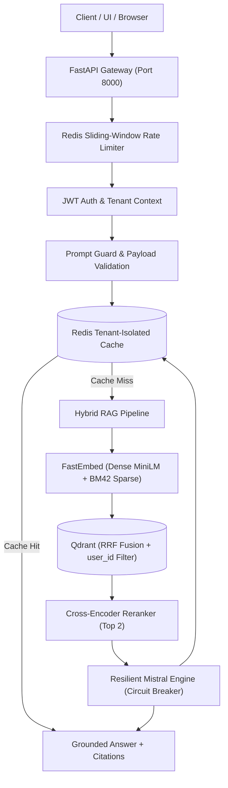

# Enterprise Hybrid RAG System

[](tests/)
[](https://fastapi.tiangolo.com)
[-dc2626)](https://qdrant.tech)
[](https://mistral.ai)
[](https://www.python.org/)

Production-grade, secure, multi-tenant Retrieval-Augmented Generation (RAG) platform combining **Dense Vector Search** (`sentence-transformers/all-MiniLM-L6-v2`), **Sparse Vector Search** (`Qdrant BM42`), **Reciprocal Rank Fusion (RRF)**, **Cross-Encoder Reranking** (`ms-marco-MiniLM-L-6-v2`), and **Mistral 8x7B** with a high-performance **FastAPI backend** and responsive **Streamlit frontend**.

---

## 🌟 Key Features & Production Hardening

- 🔐 **Multi-Tenant Identity & Authorization:** JWT authentication, bcrypt password hashing, and mathematical vector isolation enforcing `user_id == current_user.id` on all Qdrant queries.
- 🛡️ **Prompt Injection Defenses:** Direct injection heuristic screening and indirect injection containment wrapping retrieved passages inside immutable `<retrieved_evidence>` boundaries.
- 🚦 **Redis-Backed Distributed Rate Limiting:** Atomic sliding-window Lua script preventing DoS, with fail-closed protection for expensive inference routes.
- ⚡ **Multi-Tenant Caching:** Response cache with automatic invalidation on document modification and collision-proof tenant keys.
- 🔌 **LLM Fault Tolerance:** Circuit breaker, bounded retries with exponential backoff and jitter, strict timeouts, and elimination of double-inference bugs.
- 📊 **End-to-End Observability:** `X-Correlation-ID` header injection, structured JSON request logging, and granular latency breakdowns (`duration_ms`).
- 🩺 **Health & Readiness Probes:** Kubernetes/Docker-compatible `/health/live` and `/health/ready` endpoints verifying SQLite, Qdrant, and Redis.
- 📑 **Grounded Citations & Abstention:** Structured chunk citations with relevance scores, source documents, and deterministic abstention when evidence is insufficient.

---

## 🏗️ Architecture



---

## 🚀 Quickstart Guide

### 1. Installation
Clone the repository and install dependencies:
```bash
git clone <repo-url>
cd Hybrid_RAG

python -m venv venv
# Windows:
venv\Scripts\activate
# Linux/macOS:
source venv/bin/activate

pip install -r requirements.txt
```

### 2. Configure Environment
Copy `.env.example` to `.env` and provide your API keys:
```bash
cp .env.example .env
```
Key variables:
- `MistralAI`: Your Mistral API key (or leave empty to test in mock dev mode).
- `SECRET_KEY`: A random 64-character string for JWT signing.
- `Qdrant_URL` / `Qdrant_API_KEY`: Optional; defaults to local embedded storage if omitted.
- `REDIS_URL`: Optional; falls back to embedded FakeRedis if Redis daemon is not running.

### 3. Launch Backend API
Start the FastAPI server:
```bash
uvicorn src.main:app --host 0.0.0.0 --port 8000 --reload
```
Interactive OpenAPI documentation will be accessible at: `http://localhost:8000/docs`

### 4. Launch Streamlit UI
In a separate terminal window:
```bash
streamlit run src/app.py
```
Open `http://localhost:8501` in your browser. Register an account, upload a PDF, and start chatting!

---

## 🧪 Automated Test Suite

Run the complete test suite (unit, integration, security, rate limiting, and caching):
```bash
pytest tests/ -v
```

All 19 test cases pass cleanly:
```
tests/test_auth.py .......                                      [ 36%]
tests/test_caching.py ..                                        [ 47%]
tests/test_circuit_breaker.py .                                 [ 52%]
tests/test_health.py ..                                         [ 63%]
tests/test_multitenancy.py ..                                   [ 73%]
tests/test_rate_limiter.py .                                    [ 78%]
tests/test_security.py ....                                     [100%]
============================= 19 passed in 6.03s =============================
```

---

## 🐳 Docker Deployment

To launch the full production stack using Docker Compose:
```bash
docker compose up -d --build
```
This spins up:
- **FastAPI Backend:** `http://localhost:8000`
- **Streamlit Frontend:** `http://localhost:8501`
- **Qdrant Vector DB:** `http://localhost:6333`
- **Redis Cache:** `localhost:6379`

---

## 📚 Technical Documentation

- [`PRODUCTION_READINESS_AUDIT.md`](PRODUCTION_READINESS_AUDIT.md) — Comprehensive pre-implementation audit matrix.
- [`PRODUCTIONIZATION_PLAN.md`](PRODUCTIONIZATION_PLAN.md) — Architectural strategy and milestone breakdown.
- [`ARCHITECTURE.md`](ARCHITECTURE.md) — In-depth component architecture and data flow diagrams.
- [`SECURITY.md`](SECURITY.md) — Threat model, prompt injection defenses, and tenant isolation controls.
- [`ENVIRONMENT_VARIABLES.md`](ENVIRONMENT_VARIABLES.md) — Full configuration reference.
- [`PRODUCTION_DEPLOYMENT.md`](PRODUCTION_DEPLOYMENT.md) — Bare-metal, Docker, and Nginx deployment instructions.
- [`PRODUCTION_READINESS_CHECKLIST.md`](PRODUCTION_READINESS_CHECKLIST.md) — Final production readiness verification and signoff.
