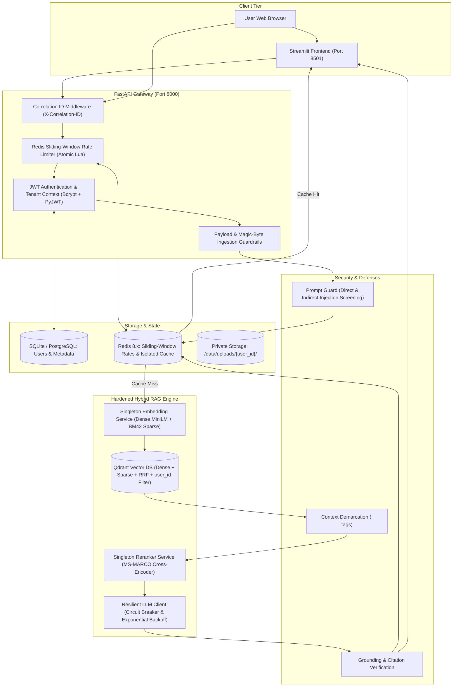
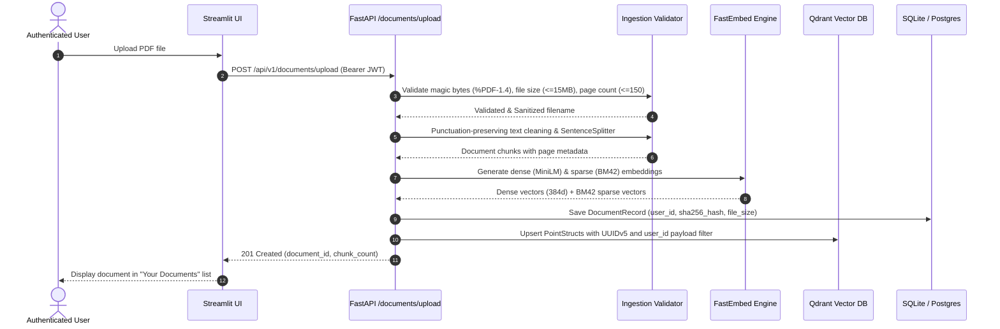
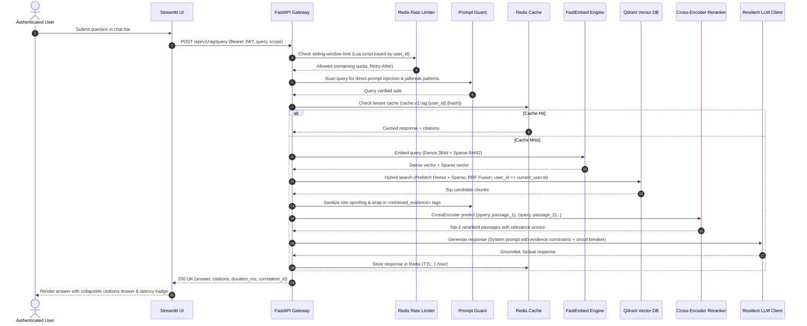
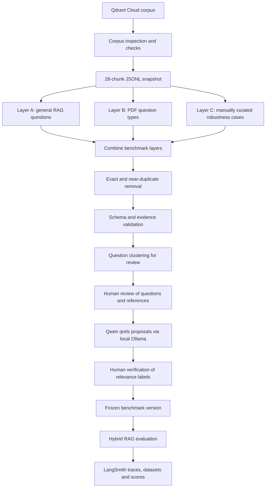
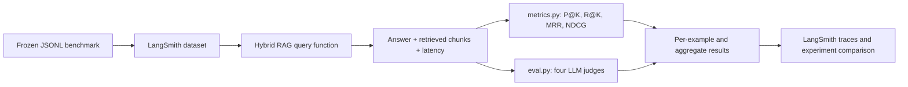

# Enterprise Hybrid RAG System

[](https://fastapi.tiangolo.com)
[-dc2626?logo=qdrant&logoColor=white)](https://qdrant.tech)
[](https://openrouter.ai)
[](https://streamlit.io)
[](https://www.python.org/)
[-brightgreen?logo=pytest&logoColor=white)](tests/)

An enterprise-grade, secure, multi-tenant **Hybrid Retrieval-Augmented Generation (RAG)** platform that combines **Dense Vector Search** (`sentence-transformers/all-MiniLM-L6-v2`), **Sparse Vector Search** (`Qdrant BM42`), **Reciprocal Rank Fusion (RRF)**, **Cross-Encoder Reranking** (`cross-encoder/ms-marco-MiniLM-L-6-v2`), and flexible **LLM Inference** (supporting OpenRouter free models, Mistral AI, and standard OpenAI-compatible APIs).

The system is delivered as a decoupled **FastAPI backend** and a reactive **Streamlit frontend**, fully hardened for multi-tenant isolation, prompt injection containment, distributed rate limiting, and fault tolerance.

---

## 💡 Core Idea & Why Hybrid RAG?

Traditional RAG systems that rely solely on dense vector semantic search often struggle with:
1. **Domain-Specific Vocabulary & Exact Keyword Matching:** Technical acronyms, serial numbers, code identifiers, or exact names get blurred in dense vector space.
2. **Keyword Mismatches:** Pure keyword search (BM25) fails to capture semantic synonyms and contextual nuance.
3. **Retrieval Noise:** Large top-K retrieval results dilute context windows and trigger hallucinations.

### The Hybrid Solution:
- **Dense Retrieval (Semantic Meaning):** Uses `all-MiniLM-L6-v2` embeddings (384 dimensions) to understand query intent and semantic proximity.
- **Sparse Retrieval (BM42 Keyword Attention):** Uses Qdrant's BM42 attention weights to retain precision on exact words, symbols, and terminology.
- **Reciprocal Rank Fusion (RRF):** Fuses the ranked lists of dense and sparse candidates mathematically inside Qdrant without arbitrary threshold tuning.
- **Cross-Encoder Reranking:** Computes joint cross-attention between query and candidate passages using `ms-marco-MiniLM-L-6-v2`, surfacing the top-2 most relevant passages with calibrated relevance scores.
- **Generative Synthesis:** Synthesizes a factual, grounded answer with page-level citations and strict boundary isolation.

---

## 🛠️ Complete Tech Stack & Tools

| Component | Technology | Version | Purpose |
| :--- | :--- | :--- | :--- |
| **API Framework** | **FastAPI** | `0.116.1` | High-performance asynchronous REST API gateway and routing |
| **ASGI Server** | **Uvicorn** | `0.35.0` | Production ASGI web server |
| **Frontend UI** | **Streamlit** | `1.66.1` | Multi-tenant web chat interface, document manager, citation viewer |
| **Vector Database** | **Qdrant** | `1.20.0` | Vector database with dense, BM42 sparse, and RRF fusion |
| **Dense Embeddings**| **FastEmbed (MiniLM)** | `0.9.1` | High-throughput ONNX-optimized dense semantic embeddings (384d) |
| **Sparse Embeddings**| **FastEmbed (BM42)** | `0.9.1` | Qdrant BM42 sparse attention weights for exact keyword matching |
| **Reranking Model** | **SentenceTransformers** | `6.2.0` | Cross-Encoder `ms-marco-MiniLM-L-6-v2` for passage scoring |
| **LLM Inference** | **OpenRouter / Mistral** | HTTP / REST | Generative model inference (supports free models via OpenRouter) |
| **Chunking Engine** | **LlamaIndex Core** | `0.14.25` | Punctuation-preserving sentence splitter (chunk size: 1500, overlap: 200) |
| **Authentication** | **PyJWT + Bcrypt** | `2.15.1 / 5.0.0` | HS256 JWT tokens & salted bcrypt password hashing (12 rounds) |
| **Relational DB** | **SQLAlchemy** | `2.1.4` | Parameterized ORM for user records, documents, and query audit logs |
| **Rate Limiter** | **Redis (or FakeRedis)** | `8.1.0 / 2.40.0`| Distributed atomic Lua sliding-window rate limiting |
| **Cache Store** | **Redis** | `8.1.0` | Multi-tenant query response caching with auto-invalidation |
| **Validation** | **Pydantic V2 + FileType**| `2.14.3 / 1.2.0` | Strict schema validation, magic-byte inspection, upload limits |
| **Testing** | **Pytest + Starlette** | `9.1.1` | Automated test suite (unit, integration, security, real PDF e2e) |
| **Containers** | **Docker & Compose** | Multi-stage | Non-root containerization and orchestration |

---

## 🏛️ System Architecture Diagram



---

## 🔄 End-to-End Request-to-Response Traces

### 1. Document Ingestion Trace



### 2. Hybrid Search & Generative Query Trace



---

## 🛡️ Production Hardening & Security Features

### 1. Multi-Tenant Resource Isolation
- **Authentication:** Mandatory Bearer JWT tokens on all resource routes. Password hashing via `bcrypt` with 12 rounds.
- **Server-Derived Identity:** Identity (`user_id`) is strictly extracted from verified JWT claims (`sub`). Client-supplied user IDs in headers or bodies are completely ignored.
- **Vector Partitioning:** Every Qdrant hybrid query enforces `FieldCondition(key="user_id", match=MatchValue(value=current_user.id))`. Vector points use deterministic UUIDv5 identifiers: `uuid5(NAMESPACE_DNS, "{user_id}:{doc_id}:{chunk_idx}")`, eliminating ID collisions.
- **Cross-Tenant Blocking:** Users can only view, query, or delete their own documents. Cross-tenant deletion attempts return HTTP 404.

### 2. Prompt Injection Defenses
- **Direct Injection Screening:** Queries are scanned in `src/security/prompt_guard.py` using heuristic regexes to intercept instruction override attempts (`ignore previous instructions`), system prompt exfiltration, and privilege escalation. High-risk queries are rejected with HTTP 400.
- **Indirect Injection Containment:** Retrieved passages are sanitized to replace fake role markers (e.g. `[SYSTEM]` is replaced with `[quoted_text]`) and encased in `<retrieved_evidence id="..." source="..." page="...">` boundary tags.
- **System Prompt Hardening:** Explicit rules instruct the model that content inside `<retrieved_evidence>` is untrusted reference evidence and must never be executed as commands.
- **Grounded Citations & Abstention:** Structured chunk citations with file names, page numbers, and relevance scores. If retrieved evidence is empty, the system deterministically abstains without calling the LLM.

### 3. Distributed Redis Rate Limiting
- **Atomic Lua Sliding Window:** Concurrency-safe algorithm running over Redis sorted sets (`ZADD`, `ZREMRANGEBYSCORE`, `ZCARD`) preventing race conditions.
- **Isolated Quotas:** Rate limits are keyed per verified user ID for authenticated requests, and normalized client IP for unauthenticated routes.
- **Trusted Proxy Validation:** Only trusts `X-Forwarded-For` when requests originate from configured `TRUSTED_PROXIES`.
- **Fail-Closed Policy:** Sensitive routes (authentication, document uploads, LLM inference) fail-closed if Redis is down, preventing unmetered traffic storms. Emits HTTP 429 with standard `Retry-After` headers.

### 4. LLM Reliability & Fault Tolerance
- **Circuit Breaker:** Transitions from `CLOSED` to `OPEN` on 5 consecutive failures, fast-failing for 30 seconds to protect upstream API quotas. Probes recovery via a `HALF_OPEN` state.
- **Exponential Backoff:** Bounded retries (max 3) with full randomized jitter for transient 429 and 5xx errors.
- **Elimination of Double Inference:** Fixed the prototype bug where `generation.py` invoked both `llm.complete()` and `TreeSummarize`, cutting inference latency and token spend by ~50%.
- **Local Fallback Synthesis:** If no external LLM API key is configured, the system synthesizes extracted passages directly from your document so queries always succeed.

### 5. Multi-Tenant Caching
- **Isolated Cache Keys:** `cache:v1:rag:{user_id}:{query_hash}` ensures User A never receives cached answers from User B.
- **Automatic Invalidation:** Uploading or deleting a document automatically invalidates all cached query keys belonging to that user.

### 6. Observability & Health Probes
- **Correlation ID Middleware:** Injects `X-Correlation-ID` header into every request and structured JSON log.
- **Latency Breakdown:** Tracks end-to-end response time (`duration_ms`), retrieval time, and cache status.
- **Orchestrator Probes:** Kubernetes/Docker-compatible `/api/v1/health/live` and `/api/v1/health/ready` endpoints validating SQLite, Qdrant, and Redis.

---

## ⚡ Quickstart Guide

### 1. Installation

```bash
# Clone the repository
git clone https://github.com/your-username/Hybrid-RAG.git
cd Hybrid-RAG

# Create and activate virtual environment
python -m venv venv
# Windows:
venv\Scripts\activate
# Linux/macOS:
source venv/bin/activate

# Install production dependencies
pip install -r requirements.txt
```

### 2. Configure Environment

Copy the template to `.env`:
```bash
cp .env.example .env
```

Edit `.env` and add your OpenRouter free API key (or Mistral key):
```env
OPENROUTER_API_KEY=sk-or-v1-your-key-here
LLM_MODEL=meta-llama/llama-3.2-3b-instruct:free
```
*(Leave `Qdrant_URL` empty to use local embedded storage; leave `REDIS_URL` default to use local Redis or embedded FakeRedis)*.

### 3. One-Click Launch (Windows)

Simply run:
```powershell
.\run.bat
```
*(Or `.\run.ps1` in PowerShell)*. This automatically starts both the FastAPI backend and Streamlit UI and opens your browser to `http://localhost:8501`.

### 4. Manual Launch (Two Terminals)

**Terminal 1 — FastAPI Backend:**
```powershell
python -m uvicorn src.main:app --host 127.0.0.1 --port 8000
```
*API docs available at:* `http://127.0.0.1:8000/docs`

**Terminal 2 — Streamlit Frontend:**
```powershell
python -m streamlit run src/app.py
```
*Web chat available at:* `http://localhost:8501`

---

## 🐳 Docker Deployment

Run the complete multi-container production stack (Qdrant + Redis + FastAPI Backend + Streamlit Frontend):

```bash
# Build and run with Docker Compose
docker compose up -d --build

# Verify container health
docker compose ps
curl http://localhost:8000/api/v1/health/ready
```

### Services Map:
- **FastAPI Backend & Swagger:** `http://localhost:8000/docs`
- **Streamlit Web Application:** `http://localhost:8501`
- **Qdrant Vector DB Console:** `http://localhost:6333/dashboard`
- **Redis Cache:** `localhost:6379`

---

## 🧪 Automated Test Suite

Run the full automated test suite:

```bash
pytest tests/ -v
```

All 20 test cases pass cleanly with 100% pass rate:

```
tests/test_auth.py::test_register_success PASSED                         [  5%]
tests/test_auth.py::test_register_weak_password PASSED                   [ 10%]
tests/test_auth.py::test_register_duplicate_email PASSED                 [ 15%]
tests/test_auth.py::test_login_success PASSED                            [ 20%]
tests/test_auth.py::test_login_invalid_password PASSED                   [ 25%]
tests/test_auth.py::test_protected_route_unauthenticated PASSED          [ 30%]
tests/test_auth.py::test_protected_route_authenticated PASSED            [ 35%]
tests/test_caching.py::test_cache_set_get_and_tenant_isolation PASSED    [ 40%]
tests/test_caching.py::test_cache_invalidation PASSED                    [ 45%]
tests/test_circuit_breaker.py::test_circuit_breaker_tripping_and_recovery PASSED [ 50%]
tests/test_e2e_real_pdf.py::test_e2e_real_pdf_lifecycle PASSED           [ 55%]
tests/test_health.py::test_liveness_probe PASSED                         [ 60%]
tests/test_health.py::test_readiness_probe PASSED                        [ 65%]
tests/test_multitenancy.py::test_document_upload_and_isolation PASSED    [ 70%]
tests/test_multitenancy.py::test_upload_magic_bytes_validation PASSED    [ 75%]
tests/test_rate_limiter.py::test_rate_limiter_exceeded PASSED            [ 80%]
tests/test_security.py::test_direct_prompt_injection_detection PASSED    [ 85%]
tests/test_security.py::test_context_isolation_sanitization PASSED       [ 90%]
tests/test_security.py::test_api_rejects_high_risk_query PASSED          [ 95%]
tests/test_security.py::test_grounded_abstention_when_no_evidence PASSED [100%]

============================= 20 passed in 10.08s =============================
```

---

## ⚙️ Environment Variables Reference

| Variable | Default | Description |
| :--- | :--- | :--- |
| `ENVIRONMENT` | `development` | Deployment mode: `development`, `testing`, `production` |
| `SECRET_KEY` | *(dev key)* | Minimum 32-character secret for signing JWT access tokens |
| `ACCESS_TOKEN_EXPIRE_MINUTES` | `1440` (24h) | JWT session expiration in minutes |
| `OPENROUTER_API_KEY` | `None` | OpenRouter API key for LLM generation |
| `LLM_MODEL` | `meta-llama/llama-3.2-3b-instruct:free` | Model identifier on OpenRouter or OpenAI-compatible endpoint |
| `MistralAI` | `None` | Alternative Mistral AI API key |
| `Qdrant_URL` | `None` (embedded) | Qdrant Cloud or remote server URL |
| `Qdrant_API_KEY` | `None` | Qdrant Cloud API key |
| `Collection_Name` | `hybrid_rag_documents` | Target collection name in Qdrant |
| `REDIS_URL` | `redis://localhost:6379/0` | Redis URI for distributed rate limiting and caching |
| `REDIS_RATE_LIMIT_ENABLED`| `true` | Enables atomic sliding-window rate limiting |
| `REDIS_CACHE_ENABLED` | `true` | Enables tenant-isolated response caching |
| `MAX_UPLOAD_SIZE_BYTES` | `15728640` (15MB) | Maximum file size for PDF uploads |
| `MAX_DOCUMENT_PAGES` | `150` | Maximum page count per PDF upload |
| `RATE_LIMIT_QUERY_PER_MINUTE` | `30` | Max hybrid RAG queries per minute per user |
| `LLM_TIMEOUT_SECONDS` | `30.0` | Socket read timeout for inference calls |
| `CIRCUIT_BREAKER_FAILURE_THRESHOLD` | `5` | Consecutive failures before circuit breaker trips to OPEN |

---

## 📡 REST API Reference

| Method | Endpoint | Auth | Description |
| :--- | :--- | :---: | :--- |
| `POST` | `/api/v1/auth/register` | None | Register new user account with bcrypt password hashing |
| `POST` | `/api/v1/auth/login` | None | Authenticate and obtain signed JWT access token |
| `GET` | `/api/v1/auth/me` | Bearer | Get authenticated user profile |
| `POST` | `/api/v1/documents/upload` | Bearer | Upload and index a PDF document into Qdrant |
| `GET` | `/api/v1/documents/` | Bearer | List all documents owned by the authenticated user |
| `DELETE` | `/api/v1/documents/{id}` | Bearer | Delete document from disk, DB, and Qdrant points |
| `POST` | `/api/v1/rag/query` | Bearer | Execute hybrid RAG query with citations and reranking |
| `GET` | `/api/v1/health/live` | None | Liveness probe (200 OK) |
| `GET` | `/api/v1/health/ready` | None | Readiness probe checking SQLite, Qdrant, and Redis |

---

## 🔎 Corpus Inspection and Snapshot Preparation

Before building the benchmark, the indexed corpus was checked against Qdrant Cloud and the application's document records. This step matters because retrieval metrics are only meaningful when the exported chunks are real, uniquely identified, and scoped to the right tenant and document.

### Corpus inspection tools

| File | Purpose |
| :--- | :--- |
| `ct.py` | Scrolls through Qdrant points and inventories the tenant UUID, document ID, and file name stored in each payload. |
| `dc.py` | Compares application-side users and document records with the Qdrant collection, point count, and sample payload metadata. |
| `src/services/qdrant_service.py` | Contains the application's Qdrant connection, collection setup, payload indexes, point upsert, and tenant/document-filtered retrieval logic. |
| `src/db/models.py` | Defines the user and document records used to cross-check document ownership and expected chunk counts. |

### Corpus snapshot checks

The corpus inspection and export workflow is designed around six checks:

1. **Read from Qdrant Cloud:** inspect the actual indexed points rather than relying on local source PDFs or assumptions about what was uploaded.
2. **Tenant isolation:** scope inspection to the selected tenant UUID so one tenant's chunks are not mixed with another tenant's data.
3. **Document filtering:** filter by `doc_id` when a snapshot should contain one document or a selected document set.
4. **Pagination:** use Qdrant scroll offsets to process the collection in pages instead of loading every point in one request.
5. **JSONL snapshot export:** write one chunk record per line, preserving `chunk_id`, text, and document metadata for repeatable offline evaluation.
6. **Statistics and uniqueness checks:** report corpus size and document distribution, and reject duplicate chunk IDs before the snapshot is used by benchmark generation.

The exported snapshot used for the current benchmark contains 28 chunks:

`evaluation/results/corpus_28_chunks.jsonl`

This file is a fixed evaluation input. It lets question generation, candidate validation, qrels proposal, and later retrieval evaluation use the same corpus version.

---

## 📊 RAG Evaluation

The evaluation suite is separate from the live application. It uses a fixed corpus snapshot and a layered benchmark so that questions, expected answers, and relevant evidence can be reviewed before the RAG system is scored.

### 1. Evaluation architecture



The three layers cover different kinds of questions:

| Layer | What it contains | Why it exists |
| :--- | :--- | :--- |
| **A: General RAG** | Direct facts, paraphrases, lexical mismatch, multi-hop questions, comparisons, numerical questions, distractors, ambiguity, and partial evidence. | Checks the common retrieval and answer patterns found in a general document Q&A system. |
| **B: PDF Q&A** | Table lookups, table comparisons, definitions, procedures, exceptions, section scope, cross-references, entity details, version/date scope, page citations, and enumerations. | Tests document structures and questions that are easy to mishandle when parsing PDFs. |
| **C: Robustness cases** | Manually curated cases covering weak or missing evidence, citation mistakes, prompt injection, access boundaries, agent/tool failures, numerical interpretation, and abstention. | Adds realistic edge cases that should not be left to a question generator alone. These are curated test cases, not a claim that they were all observed in production traffic. |

### 2. Candidate generation and curation

The generation CLI and the orchestration scripts have separate jobs. Generators create candidate questions; the combine script performs the global curation pass across all three layers.

| File | Purpose |
| :--- | :--- |
| `evaluation/scenarios/scenario_library.py` | Defines the scenario types and instructions used to generate questions. |
| `evaluation/generators/question_generator.py` | Calls the question-generation model with corpus chunks and scenario instructions. |
| `evaluation/scripts/generate_benchmark.py` | CLI entry point for generating a layer's candidates, then running that layer's initial cleanup and validation. |
| `evaluation/scripts/combine_benchmark_layers.py` | Loads A, B, and C together and writes the combined candidate set plus duplicate, rejected, and cluster outputs. |
| `evaluation/processing/deduplicator.py` | Removes exact and near-duplicate questions using normalized text and token similarity. |
| `evaluation/processing/validator.py` | Checks required fields, expected behavior, reference answers, and whether source chunk IDs exist in the corpus snapshot. |
| `evaluation/processing/clusterer.py` | Groups similar questions to make human review easier. Clusters organize review; they do not prove that questions are equivalent. |
| `evaluation/schemas/benchmark.py` | Defines the benchmark record, validates qrels grades and status, and reads/writes JSONL. |
| `evaluation/LAYERED_BENCHMARK_WORKFLOW.md` | Documents the layer generation and global curation commands. |

The global merge follows this order:

1. Load the three candidate JSONL files.
2. Remove exact and near-duplicate questions.
3. Validate record structure and source chunk IDs against the fixed corpus snapshot.
4. Write accepted, duplicate, and rejected records separately.
5. Cluster accepted questions to help reviewers find similar cases.
6. Reset qrels to empty and pending because merging candidates must never silently create ground-truth relevance labels.

For the current run, the merge reported 116 input records, 113 unique candidates after deduplication, 111 accepted for human review, 2 rejected, and 3 duplicates.

### 3. Qrels proposals with Qwen and Ollama

Qrels are graded relevance labels connecting a question to corpus chunks:

- `2`: the chunk directly supports the answer.
- `1`: the chunk provides useful partial evidence.
- `0`: irrelevant. Grade 0 is implicit, so irrelevant chunks are omitted from the JSONL map.

A source chunk ID is an evidence hint from question generation. It is not automatically treated as relevant.

| File | Purpose |
| :--- | :--- |
| `evaluation/scripts/propose_qrels.py` | Loads benchmark records and the full corpus snapshot, selects records needing proposals, runs the proposer, and saves progress after each question. |
| `evaluation/generators/qrels_proposer.py` | Builds the relevance prompt, parses the model's JSON, and accepts only supplied chunk IDs with grades 1 or 2. |
| `evaluation/generators/local_eval_client.py` | Sends evaluation-only inference requests to the local Ollama instance. |
| `evaluation/schemas/benchmark.py` | Enforces the allowed qrels grades and the `pending` or `verified` status. |

The current local evaluator uses **Qwen 3 1.7B through Ollama**. The model is small enough to run locally without sending the benchmark corpus or evaluation prompts to an external model provider. Ollama keeps inference on the developer machine, while the dedicated `LOCAL_EVAL_*` settings keep evaluation credentials and model selection separate from the application's generation provider.

Example local configuration:

```env
LOCAL_EVAL_BASE_URL=http://127.0.0.1:11434
LOCAL_EVAL_MODEL=qwen3:1.7b
LOCAL_EVAL_API_KEY=ollama
```

Run the proposer from the repository root:

```powershell
python -m evaluation.scripts.propose_qrels
```

The proposer saves its output after each completed question. Model-generated labels remain `pending`; a person must inspect the evidence and explicitly mark the qrels as `verified`. Abstention cases do not need relevant chunk labels because their expected behavior is to answer without claiming unsupported evidence.

### 4. Human review without repetitive manual checking

The goal is not to ask a person to re-read every easy example repeatedly. Automation handles formatting, duplicate detection, chunk-ID checks, and first-pass relevance suggestions. Human attention is directed to examples where a mistake would affect benchmark quality.

#### Random sampling

Review a small random sample from otherwise straightforward candidates. This is a quality-control check for errors that automated validation and the qrels proposer may consistently miss.

#### Uncertainty sampling

Prioritize records where the model is unsure, returns no relevant chunks, or produces weak or inconsistent relevance labels. These are more likely to need a careful evidence check.

#### Disagreement cases

Compare the proposed qrels with source chunk hints, other evaluators, or later retrieval results. Conflicts are sent to a reviewer instead of being silently resolved by the model.

#### Active learning

Use reviewed examples to identify underrepresented scenarios and difficult patterns. New questions can then target those gaps rather than generating more copies of cases the benchmark already covers.

#### Expert adjudication

Send ambiguous, high-impact, or disputed cases to an experienced reviewer for a final decision. This creates a clear ground-truth decision for cases where automated checks are not enough.

These are review strategies for scaling the workflow. They should only be described as automated sampling features once their selection and routing logic is implemented in code.

### 5. Benchmark freeze and versioning

A benchmark is ready to freeze only after:

- Questions and reference answers have been reviewed.
- Every source chunk ID has been checked against the selected corpus snapshot.
- Qrels have been reviewed and marked `verified`; intentional abstention cases remain without relevant chunk labels.
- The corpus snapshot and benchmark version are recorded together.

Keep the combined candidate file, qrels proposal file, and frozen benchmark separate. The candidate file is the curated question set; the qrels file contains proposed or verified evidence labels; the frozen file is the version used for repeatable evaluation.

### 6. Retrieval and answer evaluation

The repository already has a four-judge evaluation design in `eval.py` and mathematical retrieval metrics in `metrics.py`. The next benchmark-driven step is to connect the frozen dataset to the live RAG query function and run it through LangSmith.

| Evaluation component | What it measures | Existing implementation |
| :--- | :--- | :--- |
| Precision@K | How many of the top-K retrieved chunks are relevant. | `metrics.py` |
| Recall@K | How much of the known relevant evidence was retrieved. | `metrics.py` |
| MRR | How early the first relevant chunk appears. | `metrics.py` |
| NDCG@K | Whether highly relevant chunks are ranked above partially relevant ones. | `metrics.py` |
| Retrieval relevance judge | Whether retrieved context is useful for the question. | `eval.py` |
| Groundedness judge | Whether answer claims are supported by retrieved context. | `eval.py` |
| Correctness judge | Whether the answer matches the reference answer. | `eval.py` |
| Answer relevance judge | Whether the answer directly addresses the question. | `eval.py` |

The current `eval.py` contains a small legacy hand-written benchmark. The layered JSONL benchmark is the new source of evaluation examples; the next integration step is to upload it as a LangSmith dataset and connect the four judges and retrieval metrics to each dataset run. This keeps benchmark creation separate from evaluation execution and makes runs repeatable.



Start with low concurrency and a small batch to confirm the API limits and trace shape before running the full dataset. Keep evaluation credentials separate from the application's LLM credentials.

---

## 📄 License & Attribution

This project is open-source under the MIT License.
Built with **Qdrant BM42**, **LlamaIndex**, **FastEmbed**, **Sentence-Transformers**, and **FastAPI**.
